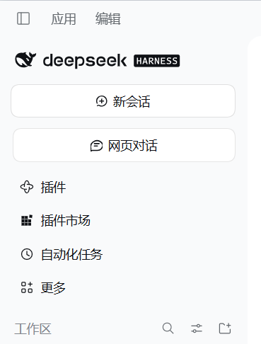
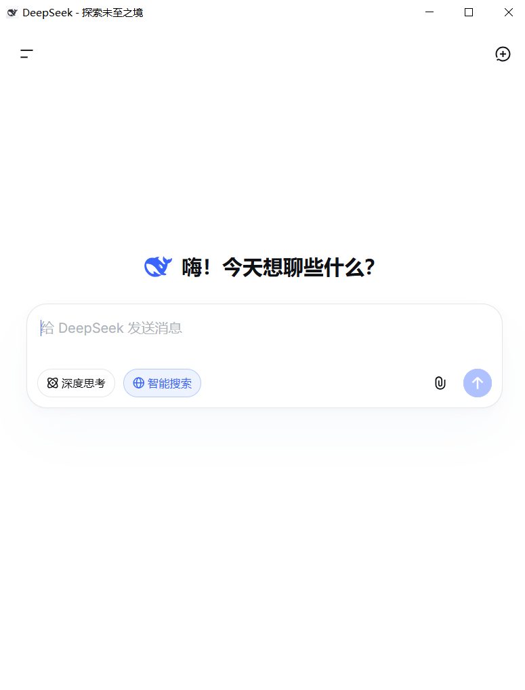

<div align="center">

# dsh-inapp-chat

**Open DeepSeek web chat without leaving DeepSeek Harness.**

Research, debug, and ask quick questions while you work, without switching to a browser.

[](https://github.com/Luminet-LT/dsh-inapp-chat)
[](https://github.com/Luminet-LT/dsh-inapp-chat)
[](./LICENSE)

[Features](#features) · [Install](#install) · [Usage](#usage) · [FAQ](#faq)

</div>

---

## Screenshots

### Sidebar entry



### In-app web chat



## Why use it

While working on a project, you often need to ask AI something outside the immediate task:

- look up an API, configuration option, or tool usage;
- understand an error message;
- compare implementation options;
- ask a quick side question.

Switching to a browser interrupts your workflow. Sending every side conversation into the current project session also consumes more context and tokens.

**dsh-inapp-chat** adds a **Web chat** entry to the DeepSeek Harness sidebar. It opens DeepSeek web chat in an in-app window, so you can research and ask questions while staying in your project.

### A better fit for everyday work

- keep research, debugging questions, and plan checks in a separate window;
- avoid switching apps and losing focus;
- use a separate web conversation and login space that does not inherit project files or chat history;
- copy only the useful result back into the project session, reducing unrelated context and token use.

In short: **ask side questions in the window, then bring only the useful result back to the project.**

## Features

- **In-app access**: open DeepSeek web chat from the Harness sidebar.
- **Built for multitasking**: look things up while working on a project.
- **Cleaner context**: web chat runs independently from the current project conversation.
- **Token-friendly**: keep short questions out of the main session and bring back only the answer.
- **Hideable entry**: turn off the sidebar entry under Settings → General.
- **Independent login**: sign in once in the chat window and keep using it.

## Install

Add the plugin from DeepSeek Harness:

```bash
dsh plugin --profile desktop add git+https://github.com/Luminet-LT/dsh-inapp-chat.git
```

Or install from a local checkout:

```bash
dsh plugin --profile desktop add link:<path-to-this-repo>
```

Restart DeepSeek Harness after installation.

## Usage

1. Open DeepSeek Harness.
2. Click **Web chat** in the left sidebar.
3. Sign in to DeepSeek the first time the window opens.
4. Research, ask questions, and close the window when you are done.

To hide the entry, open **Settings → General** and turn off **Web chat entry**.

## Still opening in the browser?

Some desktop builds need the in-app window enabled first. Use the bundled tool:

```text
tools\应用补丁并重启.cmd
```

The tool backs up the current version and restores it if something fails. To undo:

```powershell
powershell -ExecutionPolicy Bypass -File tools\dsh-shell-patch.ps1 -Action restore -Restart
```

After an app update, run the install tool again if links start opening in the browser.

## FAQ

### Does it read my current project?

No. It does not automatically read project files or send web-chat content back into the project. Copy over anything you want to keep.

### Why not ask in the current Harness session?

You can. But temporary research, error explanations, and plan checks can add a lot of unrelated context. Keeping them in a separate window leaves the main session cleaner and more token-efficient.

### Do I need to sign in separately?

Yes, sign in once in the web chat window. The login state is kept for later use.

### Can I hide the sidebar entry?

Yes. Go to **Settings → General** and turn off **Web chat entry**.

## Development and feedback

```bash
npm test
npm run check
```

Found a problem or have an idea? Open an [issue](https://github.com/Luminet-LT/dsh-inapp-chat/issues).

## License

MIT © 2026 caoganghui (upstream portions), Luminet-LT (this project)